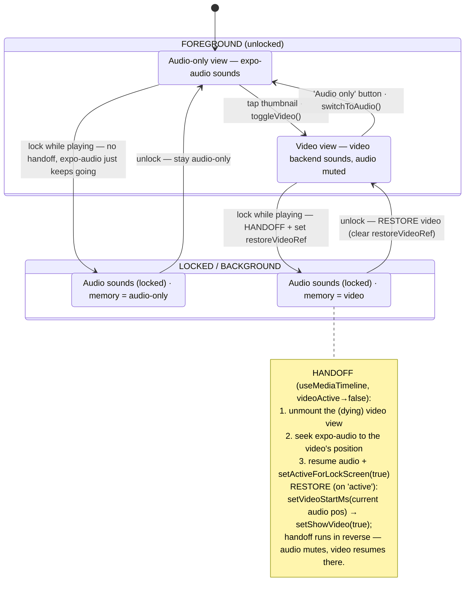
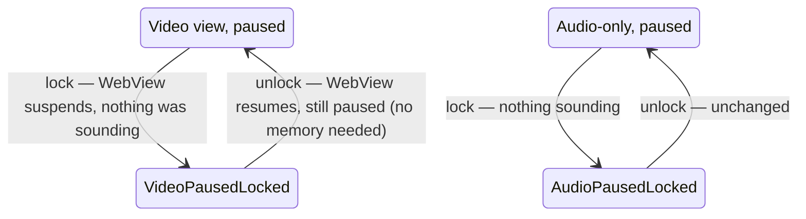
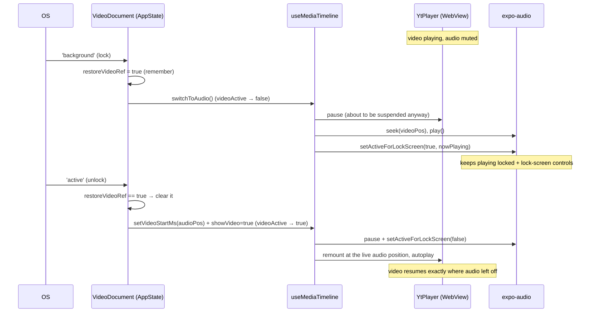

# Media playback — lock / unlock state machine

How a **video** `Document` keeps playing when the phone is locked, and how it
returns to exactly the state it was in on unlock.

Lives in `app/src/VideoDocument.tsx` (the `AppState` listener) + `app/src/useMediaTimeline.ts`
(the backend handoff) + `app/src/useAudio.ts` (the one audio player). Version introduced:
app `0.2.0`; player lifetime and background gating reworked 2026-10-03.

## The problem

Neither video backend survives a lock. The native player (`expo-video`) pauses itself
when the activity stops; the YouTube embed is a **WebView**, which the OS suspends.
Native audio does not have this problem — `expo-audio` holds an OS media session and
keeps playing when locked.

## Three backends, one timeline

`useMediaTimeline` exposes them behind one `AudioControl`; `videoActive` picks which
sounds. They never sound at once (the handoff pauses one before starting the other).
The two video backends satisfy the same `YtPlayerHandle`/`YtStatus` contract, so the
timeline does not know which one is mounted.

| Backend | Impl | Survives lock? | Sounds when |
| --- | --- | --- | --- |
| **server video** | `expo-video` (`ServerVideoPlayer`) playing the file on the phone, else the server's fetched stream | ❌ pauses itself | `videoActive`, preferred |
| **YouTube embed** | WebView (`YtPlayer`) | ❌ suspended by OS | `videoActive`, only after the server stream failed |
| **audio** | `expo-audio` (`useAudio`) | ✅ via media session | audio-only view, or handed-off-to on lock |

## The audio player lives as long as the screen

`useAudio` creates **one** player (`useAudioPlayer(null)`) and feeds it sources through
`player.replace`. It must not be `useAudioPlayer(source)`: expo-audio keys the player
on its source, so any change releases the playing player and returns a paused new one.
That is how a locked phone went silent mid-podcast — the source was built from
`activeUrl`, which the connection probe sets to `null` on a single failed probe.

- **An empty source is ignored.** A blip is not a new source.
- **Same stream, other host: keep playing.** The swap is deferred; if the current stream
  errors, the retry loads the wanted host.
- **Remote → local (a download finished), or local → remote (it was removed): swap at
  once**, restoring the position and the play intent when the new source has loaded.
- **Every swap seeks immediately after `replace`**, not when the load reports ready:
  ExoPlayer keeps a seek made while preparing, and waiting plays the start of the file.
- **A player error retries** the wanted source. In the foreground: at 2s · 5s · 15s ·
  30s · 60s, then it waits for the play button. Behind the lock: three times, at once,
  and again on the return to the foreground — see the next section for why there is
  no schedule there. Every swap, error and retry is a device-log line (`audio`); an
  error is logged at `error` level, which the log shipper sends without its timer.
- `VideoDocument` holds the last server URL that answered (`mediaBase`) for the audio
  URL, the video URL and the lock-screen claim; the transcript WebView's `baseUrl` is
  pinned to the first one. `ServerVideoPlayer` pins its source for the life of a mount.

## Behind the lock: no timers, no renders

**React Native stops every JS timer while the activity is paused**
(`JavaTimerManager.onHostPause`). `setTimeout`/`setInterval` set or pending behind the
lock fire on unlock, however late; expo-audio's foreground service keeps the process
and native events alive, but it is not a headless JS task and does not restart them.
So nothing here may depend on a timer while locked — not a retry, not the resume save,
not the connection probe (which is why a probe cannot fire locked, but one overdue
tick fires the instant the phone wakes, onto a network that is still waking). The
only heartbeat behind the lock is the audio player's own status event.

While `AppState` is not `active`, React is told nothing:

- `useAudio` listens to `playbackStatusUpdate` itself and keeps the newest status in a
  ref. `setState` only runs while active; returning to `active` publishes once.
- `useMediaTimeline.onYtStatus` does the same for the video backends, and drops a frame
  identical to the last.
- `ConnectionProvider` skips its 30s probe, and probes immediately on return.
- Whatever must still run locked reads the backend, not React state, and is driven by
  the status event, not a timer: `useAudio`'s `onBackgroundProgress` → the resume save
  (throttled to 5s by the clock) through `getPositionMs()`.

In the foreground the transcript is told about playback only when the playing
**segment** changes (`segmentIndexAt` in the host; the viewer caches its `.seg` list and
toggles two nodes). It used to get every 500ms status frame and re-scan every segment.

## The memory

The only thing we must remember across a lock is **whether the video view was open and
sounding**. If so, we hand off to audio on lock and *restore the video view on unlock*.
Audio-only sessions need no memory — `expo-audio` already survives the lock untouched.

That memory is a single ref: `restoreVideoRef` in `VideoDocument.tsx`.

## State diagram

### Paused edge cases (no sound → no handoff, no memory)

Handoff only fires when the video is **sounding** at lock time. "Sounding" is asked of
the timeline (`videoSounding()`): playing now, **or within the last second**. expo-video
pauses itself as the activity stops, and that can land before the `background` event —
a status frame that says "paused" at that moment is not evidence the listener paused.

A video view that is open but still **preparing** (the server is fetching the stream)
also collapses on lock and is restored on unlock: the audio is what is sounding, and the
video must not start up behind the lock screen.

## Round-trip sequence (video → lock → unlock)

## Invariants

1. **Never two sounds at once** — the handoff pauses one backend before starting the other.
2. **Position is continuous** across every transition (video pos → audio pos → video pos).
3. **Only the sounding backend owns the media session** — audio claims it on handoff/audio-only,
   releases it while the video WebView sounds (`setLockScreen(!videoActive && !!audioUrl, meta)`).
4. **Memory is one bit** (`restoreVideoRef`), set only on a video→lock-while-playing handoff and
   consumed on the next `'active'`. Audio-only and paused sessions carry no memory.
5. **Requires a Sam audio asset** — the handoff feeds expo-audio the offline-synced file or the
   `audioDocUrl` server stream, not the YT iframe. A doc with only a YT id and no server audio
   cannot hand off.
6. **Every open of the video view starts at the live position** (`toggleVideo` and the
   unlock restore both set `videoStartMs` from `getPositionMs()`), never at a remembered one.

## Not verified on a device

None of this can be exercised headless. In particular the lock-screen claim made during
a handoff runs with the app already in `background`, where Android 12+ may refuse to
start the foreground service. expo-audio reports that natively rather than throwing, so
`useAudio.setLockScreen` logs `lock-screen session claimed while background` — if sound
dies ~3 minutes after locking a *video*, that line is where to look.

## Code pointers

- `app/src/VideoDocument.tsx` — `AppState` listener (the state machine), `restoreVideoRef`, `nowPlaying`, `mediaBase`.
- `app/src/useMediaTimeline.ts` — backend handoff effect, `videoSounding`, `setLockScreen` on transition.
- `app/src/useAudio.ts` — the one player, source swaps, retries, background gating; `setLockScreen()` → `player.setActiveForLockScreen(...)` (no-op on web). `useAudio.web.ts` keeps the same source contract on one `<audio>` element.
- `app/src/ServerVideoPlayer.tsx` — the native video backend (pinned source).
- `app/app/_layout.tsx` — `setAudioModeAsync({ shouldPlayInBackground, interruptionMode: 'doNotMix' })`.
